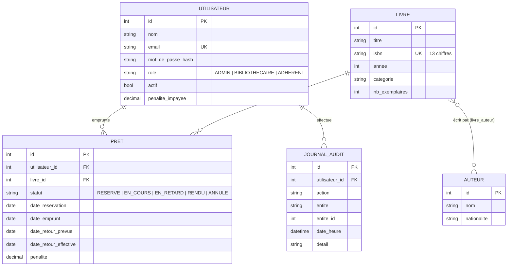

# 02 – Conception

---

## 1. Choix techniques (justification)

| Couche | Choix | Justification |
|---|---|---|
| Langage | **Python 3.12** | Un seul langage pour l'application **et** tous les outils de test (pytest, Playwright, Locust, Bandit, pip-audit). |
| Framework | **Django 6** | Framework « tout compris » : ORM, migrations, authentification, sessions, protection CSRF et interface d'administration déjà intégrés et éprouvés, donc moins de code à écrire et à sécuriser. |
| Pages web | **Templates Django** (rendu serveur) | Pas de second projet frontend à construire et à tester ; les pages restent testables en E2E avec Playwright. |
| API REST | **Django REST Framework** | Expose les mêmes données en JSON pour les tests d'API (Postman/Newman) et de performance ; pagination et permissions intégrées. |
| Base de données | **SQLite** | Aucun serveur à installer ; un seul fichier, conservé dans un volume Docker ; largement suffisant pour 10 000 livres et 20 utilisateurs simultanés. |
| Authentification | **Sessions Django** (cookie `HttpOnly`, `SameSite=Lax`) + mots de passe hachés **bcrypt** | Mécanisme natif de Django, éprouvé ; bcrypt rend les mots de passe illisibles même si la base fuit. |
| Serveur de production | **Gunicorn** + **WhiteNoise** | Gunicorn traite plusieurs requêtes en parallèle (performance) ; WhiteNoise sert le CSS sans serveur supplémentaire. |
| Portabilité | **Docker + Docker Compose** | L'application se lance avec une seule commande sur n'importe quelle machine. |

---

## 2. Architecture en couches

Django organise déjà le code en couches (modèles, vues, templates). On y ajoute une **couche métier explicite** (`services.py` et `regles.py`), pour que les règles ne soient ni dans les vues ni dans les modèles.

```
        Navigateur                     Postman / Newman / Locust
            │  HTML                          │  JSON
            ▼                                ▼
 ┌──────────────────────┐        ┌──────────────────────┐
 │  views.py + templates│        │  api.py  (DRF)       │   1. PRÉSENTATION
 └──────────┬───────────┘        └───────────┬──────────┘      reçoit la requête, vérifie le rôle,
            └───────────────┬────────────────┘                  appelle un service, renvoie la réponse
                            ▼
              ┌───────────────────────────┐
              │  services.py              │                    2. MÉTIER
              │  regles.py  (fonctions    │                       workflow, règles RM-01 à RM-07,
              │   pures, sans base)       │                       journal d'audit
              └─────────────┬─────────────┘
                            ▼
              ┌───────────────────────────┐
              │  models.py  (ORM Django)  │                    3. DONNÉES
              └─────────────┬─────────────┘                       tables, contraintes, requêtes
                            ▼
                         SQLite
```

**Règle de dépendance :** une couche n'appelle **que la couche juste en dessous**. Une vue ne contient aucune règle métier, et une règle métier ne lit jamais une requête HTTP.

**Pourquoi c'est important pour la qualité :**
- **Testabilité.** Les calculs des règles métier (pénalité, date de retour, droit de réserver) sont des **fonctions pures** dans `prets/regles.py`. Elles se testent en millisecondes, sans base ni serveur : c'est la base de la pyramide.
- **Maintenabilité (EQ-07).** Chaque fichier a un rôle unique, ce qui garde la complexité faible et localise les changements.
- **Sécurité (EQ-06).** Le contrôle des rôles se fait à un seul endroit (`comptes/permissions.py`), réutilisé par toutes les vues.

**Découpage en applications Django (une par domaine) :**

| Application | Contenu |
|---|---|
| `comptes` | Utilisateur (avec rôle), connexion, contrôle des droits |
| `catalogue` | Livre, Auteur, recherche |
| `prets` | Prêt, workflow, règles métier, tableau de bord |
| `audit` | Journal d'audit |

---

## 3. Arborescence du projet

```
bibliotheque-iso25010/
├── manage.py                   # commande Django (migrate, runserver, createsuperuser…)
├── config/
│   ├── settings.py             # paramètres (base, sécurité, applications installées)
│   ├── urls.py                 # table des adresses
│   └── wsgi.py                 # point d'entrée pour Gunicorn
├── comptes/                    # utilisateurs, rôles, connexion
│   ├── models.py               # Utilisateur (+ rôle)
│   ├── permissions.py          # vérification des rôles (→ 403)
│   ├── views.py  api.py  urls.py
│   └── migrations/
├── catalogue/                  # livres, auteurs, recherche
│   ├── models.py  services.py  views.py  api.py  urls.py
│   └── migrations/
├── prets/                      # prêts, workflow, tableau de bord
│   ├── models.py
│   ├── regles.py               # RM-01 à RM-07 en fonctions pures
│   ├── services.py             # workflow des prêts (transactions)
│   ├── views.py  api.py  urls.py
│   └── migrations/
├── audit/                      # journal d'audit
│   ├── models.py  services.py
│   └── migrations/
├── templates/                  # pages HTML
├── static/                     # CSS
├── scripts/                    # comptes de démo + 10 000 livres générés
├── tests/
│   ├── unit/                   # règles métier isolées
│   ├── integration/            # vues/API ↔ base (client de test Django)
│   ├── api/                    # collection Postman (Newman)
│   ├── e2e/                    # parcours Playwright (Chromium + Firefox)
│   ├── fiabilite/              # rollback, redémarrage, erreurs
│   └── perf/                   # locustfile.py
├── docs/                       # rapports, matrice, captures de preuve
├── Dockerfile
├── docker-compose.yml
├── requirements.txt            # dépendances de l'application
├── requirements-dev.txt        # dépendances de test et de qualité
└── pyproject.toml              # configuration pytest, couverture, Ruff
```

---

## 4. Modèle de données



**Choix de modélisation :**
- `nb_disponibles` n'est **pas stocké** : il est calculé (`nb_exemplaires − prêts actifs`), pour éviter deux valeurs contradictoires.
- Les montants utilisent `Decimal` (pas `float`) : 0,1 + 0,2 doit donner exactement 0,3.
- **Index** sur `livre.titre`, `livre.categorie` et `pret.statut`, pour que la recherche sur 10 000 livres reste sous 500 ms (EQ-02).
- Un livre qui a des prêts ne peut pas être supprimé physiquement, afin de conserver l'historique (`on_delete=PROTECT`).
- L'utilisateur est un **modèle personnalisé** (`AUTH_USER_MODEL = "comptes.Utilisateur"`), défini dès la première migration comme le recommande Django.

---

## 5. Stratégie de test (vue d'ensemble)

| Niveau | Dossier | Outil | Exigences visées |
|---|---|---|---|
| Unitaire | `tests/unit` | pytest | RM-01 à RM-07 (partitions, valeurs limites, MC/DC) |
| Intégration | `tests/integration` | pytest-django (client de test) | EF-01 à EF-10, 403 par rôle, audit |
| API | `tests/api` | Postman / Newman | Contrat HTTP (codes, format JSON) → EQ-03 |
| E2E | `tests/e2e` | Playwright | Parcours utilisateur, 2 navigateurs → EQ-03, EQ-04 |
| Fiabilité | `tests/fiabilite` | pytest | Rollback, redémarrage → EQ-05 |
| Performance | `tests/perf` | Locust | p95 < 500 ms, 20 utilisateurs → EQ-02 |
| Sécurité | – | Bandit, pip-audit, OWASP ZAP | SAST, SCA, DAST → EQ-06 |
| Qualité du code | – | Ruff, radon, pytest-cov | EQ-07 |
| Portabilité | – | Docker Compose | EQ-08 |
